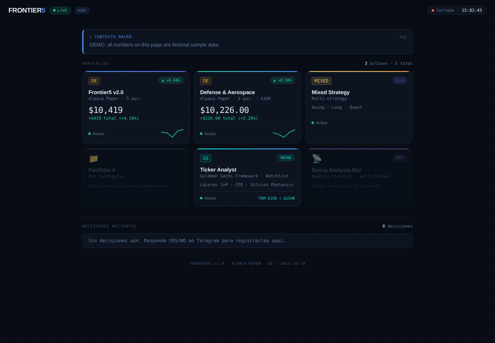
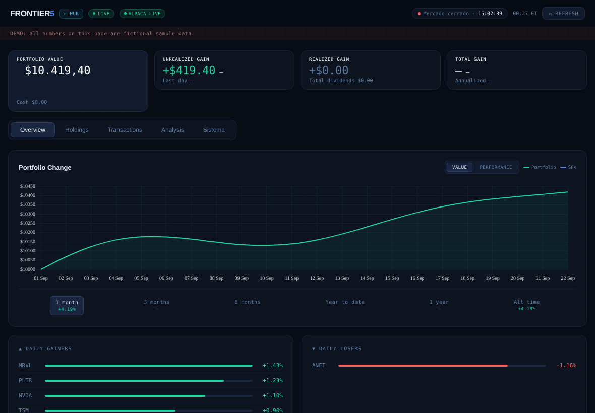
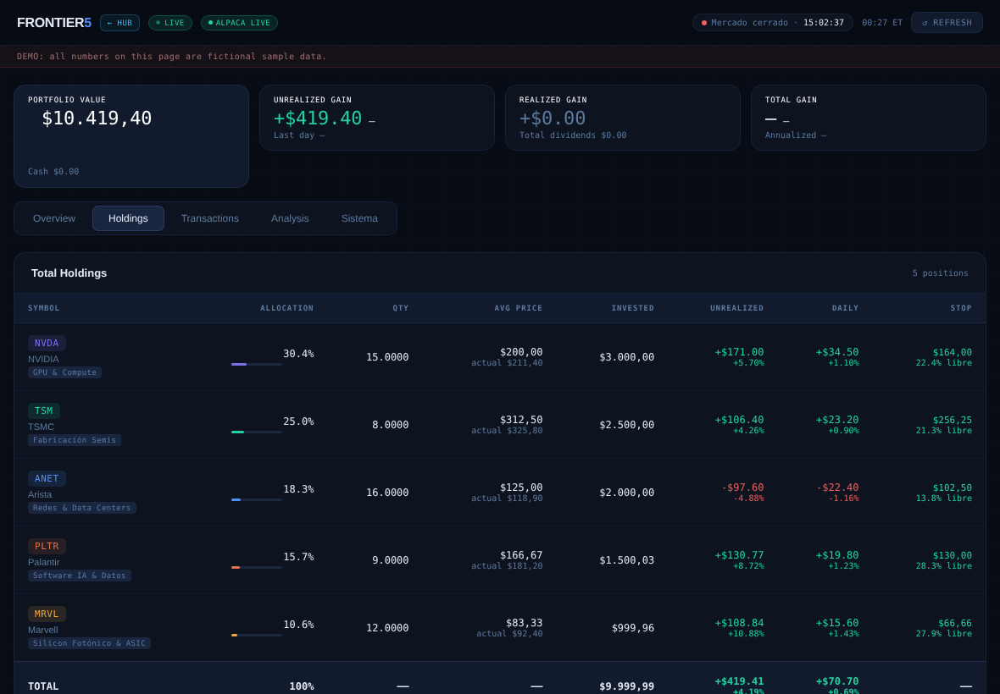
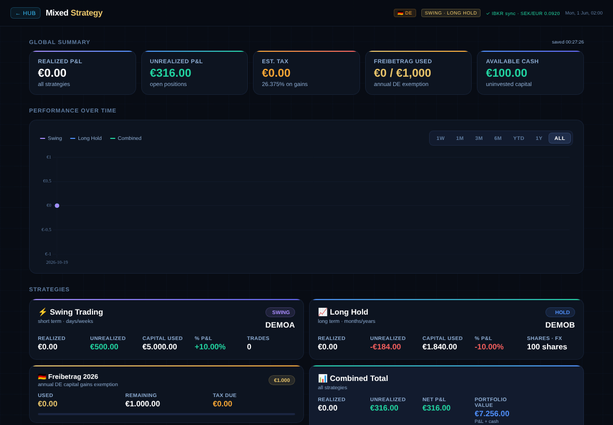
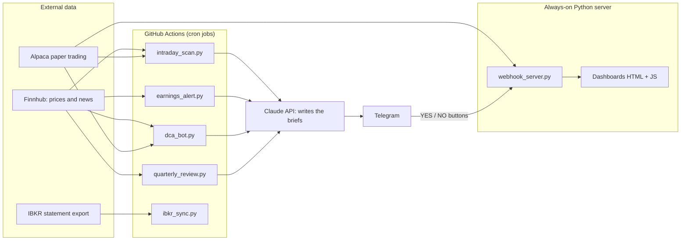

# Portfolio Manager (demo)

A small, self-built system that **watches investment portfolios, alerts me on Telegram only when something needs attention, and shows everything on web dashboards**.

It started as a personal project (internal code name *Frontier5*) to learn how to connect market data, broker APIs, scheduled jobs and a web UI into one working product. This public version contains **no real data and no real keys**. Everything you see here runs on fictional sample data or on paper-trading accounts.

> **Disclaimer:** this is an educational and portfolio project. It is not financial advice.

---

## In 60 seconds

| Question | Answer |
|----------|--------|
| What does it do? | Tracks 3 portfolios, scans prices and news, and sends short alerts to my phone. |
| What is the main idea? | **Silence means everything is fine.** A bot only speaks when a rule is triggered. |
| Does it trade by itself? | No. Alerts come with YES / NO buttons, so a human always decides. |
| What does it run on? | GitHub Actions (scheduled jobs), a small Python web server, and plain HTML/JS dashboards. |
| Which skills does it show? | Python, REST APIs, data processing, automation, dashboards, basic security hardening. |

---

## Screenshots

> Every number in these screenshots is **fictional**. They were captured with the sample snapshot and mocked API responses, so no real account data is shown.

| Hub: one page for all portfolios | AI Cycle: overview and chart |
|:--:|:--:|
|  |  |

| AI Cycle: holdings table | Mixed Strategy tracker |
|:--:|:--:|
|  |  |

---

## How it works



1. **Scheduled jobs** run on GitHub Actions and pull data from market and broker APIs.
2. If a rule is triggered (for example a big price drop), the job asks **Claude** to write a short brief and sends it to **Telegram**.
3. I answer with the **YES / NO** buttons. The web server receives the answer through a Telegram webhook and records it.
4. The **dashboards** read live numbers from the same server, so I can check everything in one place.

---

## The three portfolios

| # | Name | Idea | Data source |
|---|------|------|-------------|
| 1 | **AI Cycle** | Five stocks that cover the AI value chain: GPUs, chip manufacturing, networking, software and photonics. | Alpaca **paper** trading |
| 2 | **Defense & Aerospace** | Five defense companies across missiles, platforms, electronics, naval and drones. | Alpaca **paper** trading |
| 3 | **Mixed Strategy** | A tracker that reads a weekly brokerage statement export (IBKR Flex Query). | Snapshot file (**sample data** in this repo) |

Each portfolio is a small config class in `configs/`. The bots do not know which portfolio they are running: they read the `PORTFOLIO_ID` environment variable and load the matching config. Adding a new portfolio does not require touching the bot code.

---

## The bots

| Bot | File | When it runs | What it does |
|-----|------|--------------|--------------|
| Intraday scan | `intraday_scan.py` | Twice a day on market days (09:15 and 15:45 ET) | Alerts when a position drops more than 5% in a day, moves more than 7% in either direction, breaks its stop-loss, or has critical news. |
| Earnings pre-alert | `earnings_alert.py` | Daily at 08:00 ET | Sends a brief 48 h and 24 h before a company reports earnings. |
| Cash redeployment | `dca_bot.py` | Daily on market days | If there is idle cash (over $100) it analyses the remaining positions with RSI and EMA-20 and suggests where to put it, or to hold cash. |
| Quarterly review | `quarterly_review.py` | Automatically once all 5 positions have reported earnings, or manually | Pulls fundamentals, analyst changes and insider transactions, then rates each thesis as intact, to review or broken. |
| Tax-allowance helper | `freibetrag_bot.py` | Manual run (designed for December) | Calculates how many shares to sell and rebuy to use the yearly German tax-free capital gains allowance. |
| IBKR sync | `ibkr_sync.py` | On market days after the close (GitHub Actions) | Downloads a brokerage statement, converts it into a clean JSON snapshot and masks the account number. |

---

## The dashboards

All dashboards are plain HTML, CSS and JavaScript (charts with Chart.js). They are installable as a phone app (PWA) through `dashboard/manifest.json`.

| Page | URL path | What you see |
|------|----------|--------------|
| Hub | `/` | Landing page that links to everything. |
| AI Cycle | `/dashboard` | Positions, P&L since entry, daily performance, distance to stop-loss. |
| Defense & Aerospace | `/dashboard/defense` | Same view for portfolio 2. |
| Mixed Strategy Tracker | `/dashboard/mixed` | Overview, holdings, transactions and analysis tabs built from the IBKR snapshot. |
| Ticker Analyst | `/dashboard/photonics` | A watchlist with a small chat that asks Claude about a ticker. |

Telegram commands: `/status` (current portfolio snapshot) and `/help`.

---

## Design principles

These are the decisions I care about most in this project:

- **Quiet by default.** No daily noise. An alert exists only when a rule says so.
- **Human in the loop.** The system recommends. I confirm.
- **Paper trading first.** The Alpaca scripts check that the account is a paper account before doing anything.
- **No secrets in code.** Keys are read from environment variables or GitHub Secrets.
- **Closed by default.** Every `/api/*` route needs a token. If the token is not configured, the API stays disabled instead of open.
- **One config per portfolio.** Behaviour changes through configuration, not through copy-pasted code.

---

## Try it locally (no API keys needed)

You only need Python 3.10 or newer.

```bash
# 1. Get the code
git clone https://github.com/fcheca93/Portfolio-Manager-demo.git
cd Portfolio-Manager-demo

# 2. Install dependencies
pip install -r requirements.txt

# 3. Choose a token for the dashboards (any text you like)
export DASHBOARD_TOKEN=my-local-token        # Windows PowerShell: $env:DASHBOARD_TOKEN="my-local-token"

# 4. Start the server
python webhook_server.py
```

Then open `http://localhost:8080/` in your browser. The page asks for the token once: use the same text you set in step 3.

You can also check the sample snapshot from the command line:

```bash
curl -H "X-Dashboard-Token: my-local-token" http://localhost:8080/api/ibkr/snapshot
```

Without keys, the pages that need live Alpaca or Finnhub data will show empty or error states. The Mixed Strategy data comes from `ibkr_snapshot.sample.json`.

---

## Configuration

### Environment variables and secrets

| Name | Used for |
|------|----------|
| `DASHBOARD_TOKEN` | Shared secret required by every `/api/*` route (set it on the server). |
| `FINNHUB_API_KEY` | Prices, news, fundamentals, earnings calendar. |
| `ANTHROPIC_API_KEY` | Claude writes the alert briefs. |
| `TELEGRAM_TOKEN` and `TELEGRAM_CHAT_ID` | Sending alerts and receiving button answers. |
| `ALPACA_API_KEY` and `ALPACA_SECRET_KEY` | Paper account of portfolio 1. |
| `ALPACA_API_KEY_DEFENSE` and `ALPACA_SECRET_KEY_DEFENSE` | Paper account of portfolio 2. |
| `ALPACA_API_KEY_MIXED` and `ALPACA_SECRET_KEY_MIXED` | Optional account for portfolio 3 endpoints. |
| `IBKR_FLEX_TOKEN` and `IBKR_FLEX_QUERY_ID` | Weekly statement download. |
| `PORTFOLIO_ID` | Which portfolio config a bot loads (`frontier5_v2` or `defense_aerospace`). |
| `COMMIT_SNAPSHOT` | Set to `true` only in a **private** repo to let the sync commit its snapshot. |

### Add a new portfolio

1. Copy `configs/defense_aerospace.py` to `configs/my_portfolio.py` and edit tickers, weights and rules.
2. Register it in `PORTFOLIO_REGISTRY` inside `config.py`.
3. Set `PORTFOLIO_ID=my_portfolio` in the workflow that should use it.

### GitHub Actions

The workflows are included for reference. In a fresh copy of this repo they will fail because the secrets are not set, so keep Actions disabled until you add them (Settings, Actions, General).

---

## Project structure

```
Portfolio-Manager-demo/
├── config.py                  # Picks the portfolio config from PORTFOLIO_ID
├── configs/                   # One config class per portfolio
├── utils.py                   # Shared helpers: Finnhub, Claude, Telegram
├── state.py                   # Saves the YES / NO decisions
├── alpaca_client.py           # Alpaca paper-trading client
├── intraday_scan.py           # Alert scanner
├── earnings_alert.py          # Earnings pre-briefs
├── dca_bot.py                 # Cash redeployment suggestions
├── quarterly_review.py        # Quarterly thesis review
├── freibetrag_bot.py          # German tax-allowance helper
├── ibkr_sync.py               # Brokerage statement to JSON snapshot
├── ibkr_snapshot.sample.json  # Fictional sample data
├── open_portfolio_*.py        # One-time scripts to open the paper portfolios
├── Sync_positions.py          # One-time position sync script
├── webhook_server.py          # Web server: dashboards, API, Telegram webhook
├── dashboard/                 # HTML dashboards and PWA files
├── docs/images/               # Screenshots used in this README
└── .github/workflows/         # Scheduled and manual jobs
```

---

## Tech stack

Python (requests, pytz, alpaca-trade-api) · GitHub Actions · Finnhub API · Alpaca API · Interactive Brokers Flex Query · Telegram Bot API · Anthropic Claude API · HTML, CSS and JavaScript · Chart.js · Render (hosting)

## What I learned

- Building and chaining several third-party REST APIs, with error handling for each.
- Turning a manual routine into scheduled, automated jobs.
- Designing a data flow from raw statement to dashboard.
- Securing a public project: finding exposed endpoints, removing real data and moving every secret to the environment.
